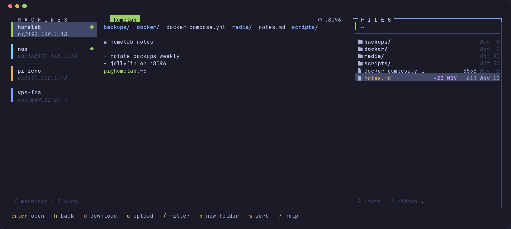
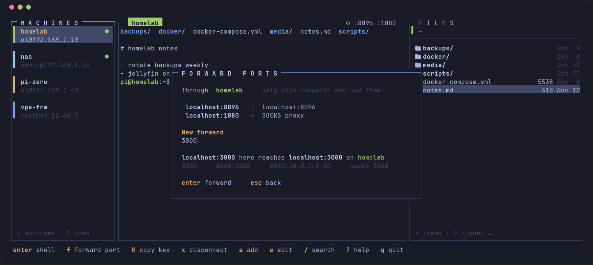
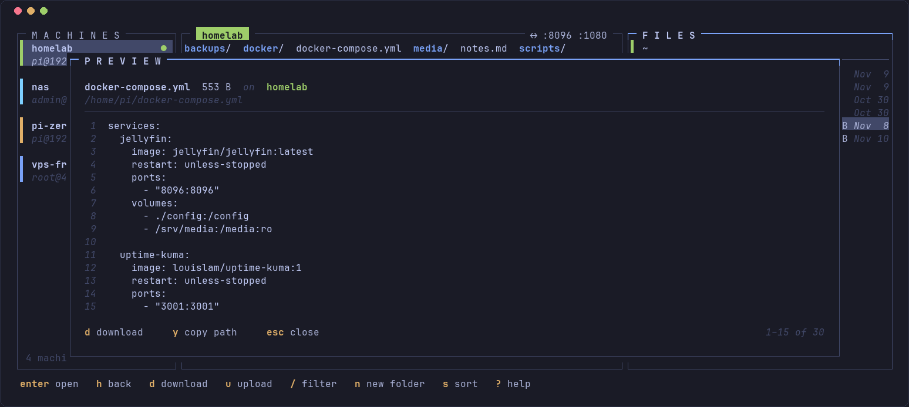
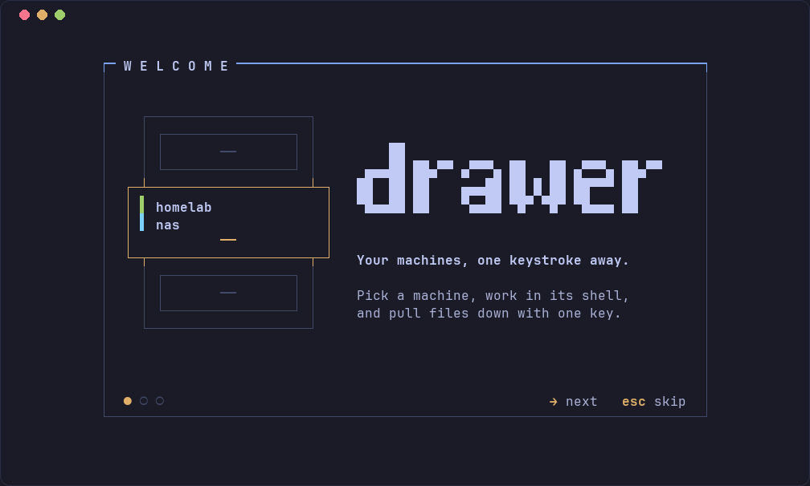

<div align="center">

# drawer

**Your SSH machines, a live shell and their files on one terminal screen.**

[](https://github.com/nvrma/drawer/actions/workflows/ci.yml)
[](https://github.com/nvrma/drawer/releases)
[](LICENSE)

[**Website & docs**](https://nakulv.com/drawer/) · [Releases](https://github.com/nvrma/drawer/releases) · [Changelog](CHANGELOG.md)



</div>

drawer is a fast terminal app for the machines you SSH into every day: homelab boxes, Raspberry Pis, a NAS, a VPS. It's built for the keyboard and works with the mouse too. Pick a machine on the left and you get a real shell in the middle and that machine's files on the right. Press `d` to download a file or folder, `u` to upload one, `p` to preview one, and `f` to forward a port. There's nothing to sign up for and no separate vault: your machines come straight from `~/.ssh/config`.

## Install

```sh
curl -fsSL https://nakulv.com/drawer/install.sh | sh
```

The script:
- downloads the prebuilt binary for your system (Linux or macOS, x86_64 or ARM64);
- checks its SHA-256 checksum;
- installs it to `~/.local/bin`, with no `sudo`.

To install somewhere else, set `DRAWER_INSTALL_DIR`. You can [read the script first](install.sh) if you'd like.

<details>
<summary>Other ways to install</summary>

**With Cargo** (Rust 1.88+):

```sh
cargo install --locked --git https://github.com/nvrma/drawer
```

**From source:**

```sh
git clone https://github.com/nvrma/drawer && cd drawer
cargo build --release
./target/release/drawer
```

</details>

drawer needs the OpenSSH client (`ssh`), which almost every Linux and macOS system already has. For icons, use a [Nerd Font](https://www.nerdfonts.com); without one, set `DRAWER_NO_ICONS=1`.

## Features

- **Three panes, one screen:** machines, a full interactive shell (colours, `vim`, `htop`, everything), and a file browser for the same machine.
- **One login per machine:** the file browser and port forwards reuse the shell's connection, so you type your password (or use your key) once.
- **Mouse and keyboard:** click to focus and pick, double-click to connect or open, scroll anything with the wheel, and drag in the shell to copy text. Every key hint can be clicked. Everything still works from the keyboard alone.
- **Scrollback that works:** scroll the shell with the wheel or `Alt+PgUp`, even in terminals that keep `Shift+PgUp` for themselves. `Alt+z` zooms the shell to the full window.
- **Download and upload:** files or whole folders. A confirmation shows exactly what goes where, nothing is ever overwritten, and progress shows speed and time left.
- **Preview and manage files:** read text files in place, and filter, sort, rename, delete or make folders without leaving the file pane.
- **Port forwarding:** reach a machine's web UI or database at `localhost`, or start a SOCKS proxy, with one key. Forwards listen on `127.0.0.1` only.
- **Manage machines in the app:** add, edit, delete and search. Changes are written to your real ssh config, so `ssh`, `scp` and every other tool see them too.
- **Stop typing passwords:** press `K` on a connected machine to install your SSH key there.
- **Many sessions at once:** switching machines keeps the others connected.
- **Matches your terminal:** drawer uses only your terminal's own colour palette, so it fits any theme and changes along with it.
- **A guided first run:** a short welcome tour checks your setup and shows the keys.

<table>
<tr>
<td></td>
<td></td>
</tr>
<tr>
<td align="center"><sub>Forward a port with <code>f</code></sub></td>
<td align="center"><sub>Preview a file with <code>p</code></sub></td>
</tr>
</table>



## Getting started

1. Run `drawer`. The first launch shows a short welcome tour.
2. Your machines from `~/.ssh/config` are listed on the left. If you have none yet, press `a` to add one.
3. Select a machine and press `Enter`. If ssh asks to confirm a new host's fingerprint or for a password, answer in the middle pane, just like plain `ssh`.
4. Press `Alt+3` (or click the files pane) to browse with `Enter` and `h`. Press `p` to preview a file and `d` to download it into `~/Downloads`.
5. Need a machine's web UI? Select the machine, press `f`, type its port (say `8006`) and open `localhost:8006` in your browser.

## Keys

| Where | Key | What it does |
|---|---|---|
| anywhere | `Alt+1` `Alt+2` `Alt+3` | focus machines, shell, files |
| anywhere | `Alt+z` | zoom the shell to the whole window (again to go back) |
| anywhere | `Alt+q` | quit |
| outside the shell | `Tab`, `?` | next pane, all keys |
| machines | `Enter`, `j` `k` | connect or switch, move |
| machines | `a` `e` `D` | add, edit, delete a machine |
| machines | `/` | search |
| machines | `f` | forward a port through the machine |
| machines | `K` | copy your SSH key to the machine |
| machines | `x`, `r` | close the session, reload config |
| shell | `Alt+PgUp` `Alt+PgDn` | scroll back (`Shift+PgUp` works too where your terminal allows) |
| shell, scrolled back | `↑` `↓` `PgUp` `PgDn`, `Esc` | move through history, back to live |
| files | `Enter` `h` `~` | open folder or preview file, go up, go home |
| files | `p` | preview a text file |
| files | `d` then `y` | download file or folder |
| files | `u` | upload a file or folder |
| files | `/`, `s` | filter, sort (name, newest, largest) |
| files | `n` `R` `D` | new folder, rename, delete |
| files | `y`, `c` | copy the path, type `cd` to this folder into the shell |
| files | `.`, `r` | show hidden files, refresh |

In the shell every key goes to the remote machine except the `Alt` shortcuts.

### Mouse

| Where | Mouse | What it does |
|---|---|---|
| anywhere | click | focus a pane, pick a machine or file, press a key hint |
| machines, files | double-click | connect; open a folder or preview a file |
| anywhere | wheel | scroll the list, preview or shell |
| shell | drag | select text and copy it to the clipboard |
| shell | double-click, triple-click | copy a word, copy a line |
| shell | `Shift`+drag | your terminal's own selection |

When a program in the shell uses the mouse (`htop`, `vim` with `mouse=a`, `tmux`), it gets your clicks and wheel instead; hold `Shift` to select text anyway. In full-screen programs that don't use the mouse, such as `less` and `man`, the wheel scrolls the program, as it would in your terminal. Copying uses your terminal's clipboard support (OSC 52) and, on your own computer, `wl-copy`, `xclip`, `xsel` or `pbcopy` if one is installed. To turn the mouse off and leave it to your terminal, set `DRAWER_NO_MOUSE=1`.

## Security

drawer is built so it never has to be trusted with your secrets.

- **Your OpenSSH does the connecting.** drawer runs your system `ssh` client, so host keys are checked against `~/.ssh/known_hosts`. New fingerprints are shown for you to confirm, a changed host key makes ssh refuse to connect, and keys, `ssh-agent`, `ProxyJump` and `Match` blocks all behave exactly as they do in plain `ssh`. drawer has no option to skip these checks.
- **Passwords never touch drawer.** You type them into ssh's own prompt. drawer never reads, stores or logs them.
- **Private connection sharing.** The file browser shares the shell's connection through an OpenSSH control socket in a private folder (`$XDG_RUNTIME_DIR/drawer`, mode `0700`, ownership checked). It runs in `BatchMode`, so it can never prompt you.
- **Safe transfers:**
  - Remote file names are cleaned up before they touch your disk (no `..`, `/` or control characters).
  - Nothing is ever overwritten; you get `name (1).ext` instead.
  - Unfinished downloads stay hidden until they're complete.
  - Symlinks inside folders are skipped, never followed.
- **Safe config edits:**
  - Machine fields are strictly validated, so a value can't inject extra ssh options such as `ProxyCommand`.
  - Symlinked dotfiles stay symlinks.
  - Files are replaced atomically with their permissions kept, and the old version is saved as `<file>.drawer.bak`.
  - Nothing is written if the file changed on disk in the meantime.
- **Safe key install:** `K` sends only your *public* key, over stdin to a fixed remote script, and skips it if it's already there.
- **Private port forwards:** forwards are added to the existing connection with `ssh -O forward` and always listen on `127.0.0.1`, so other computers on your network can't use them. The target host and ports are strictly validated.
- **Careful file actions:** delete asks first and only a literal `y` confirms (never `Enter`). Folders are deleted without following links inside them. Rename and new folder never replace something that already exists. `c` types the `cd` command into the shell but never presses Enter for you.
- **The remote can't take over your terminal.** Shell output goes through a terminal emulator inside drawer, and file names are shown with control characters replaced.

Found a security problem? Please see [SECURITY.md](SECURITY.md).

## Configuration

drawer has no config file of its own. It reads `~/.ssh/config`, including every file pulled in with `Include`.

| Variable | Effect |
|---|---|
| `DRAWER_CONFIG=/path/to/config` | use another ssh config file (like `ssh -F`) |
| `DRAWER_NO_ICONS=1` | plain symbols instead of Nerd Font icons |
| `DRAWER_NO_MOUSE=1` | don't use the mouse; leave it to your terminal |

Run `drawer --welcome` to see the welcome tour again, or `drawer --help` for all options.

## Updating

Run the install command again. It replaces the binary with the latest release. drawer keeps no state of its own, so there's nothing to migrate:

```sh
curl -fsSL https://nakulv.com/drawer/install.sh | sh
drawer --version
```

To pin a version, set `DRAWER_VERSION`, for example `DRAWER_VERSION=v0.2.0`. If you installed with Cargo, run `cargo install --locked --force --git https://github.com/nvrma/drawer`. Quit drawer before updating; open sessions close when it quits. See the [changelog](CHANGELOG.md) for what's new.

## FAQ

**The mouse wheel or `Shift+PgUp` doesn't scroll the shell.** Update to 0.2.0 or newer, which captures the mouse and adds `Alt+PgUp`. Many terminals (Ghostty, kitty and others) use `Shift+PgUp` for their own scrollback, so it never reaches drawer.

**How do I select text the way my terminal normally does?** Hold `Shift` while you drag, or set `DRAWER_NO_MOUSE=1`. Dragging inside the shell pane without `Shift` already copies the text for you.

**Where do new machines get saved?** In the config file that already holds most of your machines; the form shows the exact path before you save. With an empty config, they go to `~/.ssh/config.d/drawer.conf` if your config includes that folder, otherwise `~/.ssh/config`.

**Does it work on Windows?** Not yet. drawer targets Linux and macOS; it may work under WSL.

**Can I use it with a jump host or ssh-agent?** Yes. drawer runs your real `ssh`, so anything in your config works.

## Contributing

Bug reports and pull requests are welcome; see [CONTRIBUTING.md](CONTRIBUTING.md). The design rules for the interface are in [DESIGN.md](DESIGN.md).

## License

[MIT](LICENSE) © Nakul Verma
