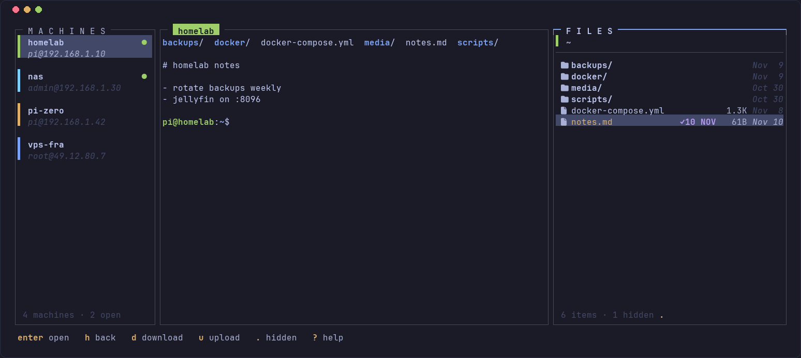
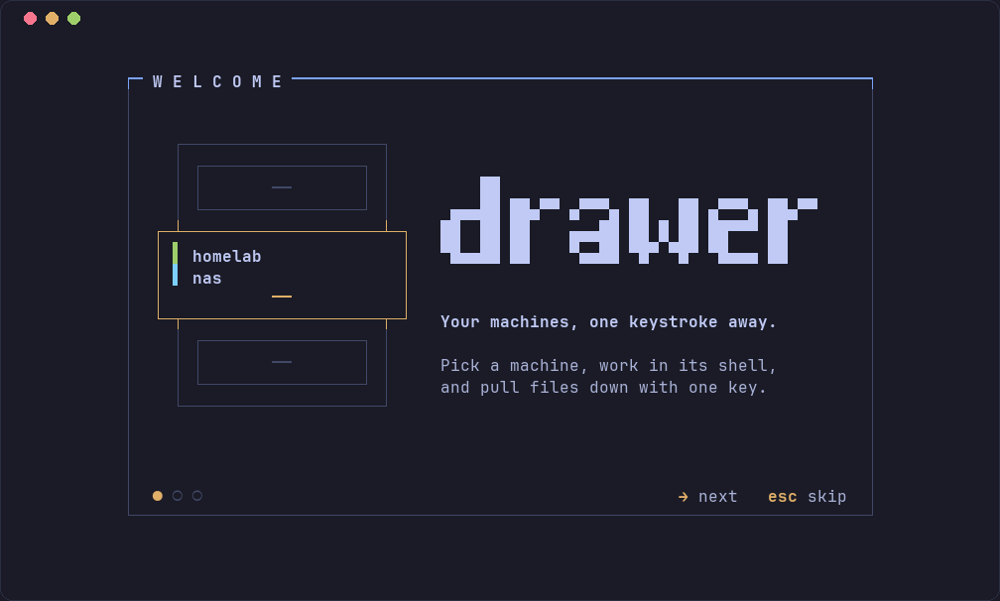

<div align="center">

# drawer

**Your SSH machines, a live shell and their files on one terminal screen.**

[](https://github.com/nvrma/drawer/actions/workflows/ci.yml)
[](https://github.com/nvrma/drawer/releases)
[](LICENSE)



</div>

drawer is a fast, keyboard-driven terminal app for the machines you SSH into every day: homelab boxes, Raspberry Pis, a NAS, a VPS. Pick a machine on the left and you get a real shell in the middle and that machine's files on the right. Press `d` to download a file or folder and `u` to upload one. There's nothing to sign up for and no separate vault: your machines come straight from `~/.ssh/config`.

## Install

```sh
curl -fsSL https://raw.githubusercontent.com/nvrma/drawer/main/install.sh | sh
```

The script:
- downloads the prebuilt binary for your system (Linux or macOS, x86_64 or ARM64);
- checks its SHA-256 checksum;
- installs it to `~/.local/bin`, with no `sudo`.

To install somewhere else, set `DRAWER_INSTALL_DIR`. You can [read the script first](install.sh) if you'd like.

<details>
<summary>Other ways to install</summary>

**With Cargo** (Rust 1.88+):

```sh
cargo install --locked --git https://github.com/nvrma/drawer
```

**From source:**

```sh
git clone https://github.com/nvrma/drawer && cd drawer
cargo build --release
./target/release/drawer
```

</details>

drawer needs the OpenSSH client (`ssh`), which almost every Linux and macOS system already has. For icons, use a [Nerd Font](https://www.nerdfonts.com); without one, set `DRAWER_NO_ICONS=1`.

## Features

- **Three panes, one screen:** machines, a full interactive shell (colours, `vim`, `htop`, everything), and a file browser for the same machine.
- **One login per machine:** the file browser reuses the shell's connection, so you type your password (or use your key) once.
- **Download and upload:** files or whole folders. A confirmation shows exactly what goes where, nothing is ever overwritten, and progress shows speed and time left.
- **Manage machines in the app:** add, edit, delete and search. Changes are written to your real ssh config, so `ssh`, `scp` and every other tool see them too.
- **Stop typing passwords:** press `K` on a connected machine to install your SSH key there.
- **Many sessions at once:** switching machines keeps the others connected.
- **Matches your terminal:** drawer uses only your terminal's own colour palette, so it fits any theme and changes along with it.
- **A guided first run:** a short welcome tour checks your setup and shows the keys.



## Getting started

1. Run `drawer`. The first launch shows a short welcome tour.
2. Your machines from `~/.ssh/config` are listed on the left. If you have none yet, press `a` to add one.
3. Select a machine and press `Enter`. If ssh asks to confirm a new host's fingerprint or for a password, answer in the middle pane, just like plain `ssh`.
4. Press `Alt+3` to jump to the files pane, browse with `Enter` and `h`, and press `d` to download into `~/Downloads`.

## Keys

| Where | Key | What it does |
|---|---|---|
| anywhere | `Alt+1` `Alt+2` `Alt+3` | focus machines, shell, files |
| anywhere | `Alt+q` | quit |
| outside the shell | `Tab`, `?` | next pane, all keys |
| machines | `Enter`, `j` `k` | connect or switch, move |
| machines | `a` `e` `D` | add, edit, delete a machine |
| machines | `/` | search |
| machines | `K` | copy your SSH key to the machine |
| machines | `x`, `r` | close the session, reload config |
| shell | `Shift+PgUp` `Shift+PgDn` | scroll back |
| files | `Enter` `h` `~` | open folder, go up, go home |
| files | `d` then `y` | download file or folder |
| files | `u` | upload a file or folder |
| files | `.`, `r` | show hidden files, refresh |

In the shell every key goes to the remote machine except the `Alt` shortcuts. drawer doesn't capture the mouse, so your terminal's normal text selection and copy still work.

## Security

drawer is built so it never has to be trusted with your secrets.

- **Your OpenSSH does the connecting.** drawer runs your system `ssh` client, so host keys are checked against `~/.ssh/known_hosts`. New fingerprints are shown for you to confirm, a changed host key makes ssh refuse to connect, and keys, `ssh-agent`, `ProxyJump` and `Match` blocks all behave exactly as they do in plain `ssh`. drawer has no option to skip these checks.
- **Passwords never touch drawer.** You type them into ssh's own prompt. drawer never reads, stores or logs them.
- **Private connection sharing.** The file browser shares the shell's connection through an OpenSSH control socket in a private folder (`$XDG_RUNTIME_DIR/drawer`, mode `0700`, ownership checked). It runs in `BatchMode`, so it can never prompt you.
- **Safe transfers:**
  - Remote file names are cleaned up before they touch your disk (no `..`, `/` or control characters).
  - Nothing is ever overwritten; you get `name (1).ext` instead.
  - Unfinished downloads stay hidden until they're complete.
  - Symlinks inside folders are skipped, never followed.
- **Safe config edits:**
  - Machine fields are strictly validated, so a value can't inject extra ssh options such as `ProxyCommand`.
  - Symlinked dotfiles stay symlinks.
  - Files are replaced atomically with their permissions kept, and the old version is saved as `<file>.drawer.bak`.
  - Nothing is written if the file changed on disk in the meantime.
- **Safe key install:** `K` sends only your *public* key, over stdin to a fixed remote script, and skips it if it's already there.
- **The remote can't take over your terminal.** Shell output goes through a terminal emulator inside drawer, and file names are shown with control characters replaced.

Found a security problem? Please see [SECURITY.md](SECURITY.md).

## Configuration

drawer has no config file of its own. It reads `~/.ssh/config`, including every file pulled in with `Include`.

| Variable | Effect |
|---|---|
| `DRAWER_CONFIG=/path/to/config` | use another ssh config file (like `ssh -F`) |
| `DRAWER_NO_ICONS=1` | plain symbols instead of Nerd Font icons |

Run `drawer --welcome` to see the welcome tour again, or `drawer --help` for all options.

## FAQ

**Where do new machines get saved?** In the config file that already holds most of your machines; the form shows the exact path before you save. With an empty config, they go to `~/.ssh/config.d/drawer.conf` if your config includes that folder, otherwise `~/.ssh/config`.

**Does it work on Windows?** Not yet. drawer targets Linux and macOS; it may work under WSL.

**Can I use it with a jump host or ssh-agent?** Yes. drawer runs your real `ssh`, so anything in your config works.

## Contributing

Bug reports and pull requests are welcome; see [CONTRIBUTING.md](CONTRIBUTING.md). The design rules for the interface are in [DESIGN.md](DESIGN.md).

## License

[MIT](LICENSE) © Nakul Verma
